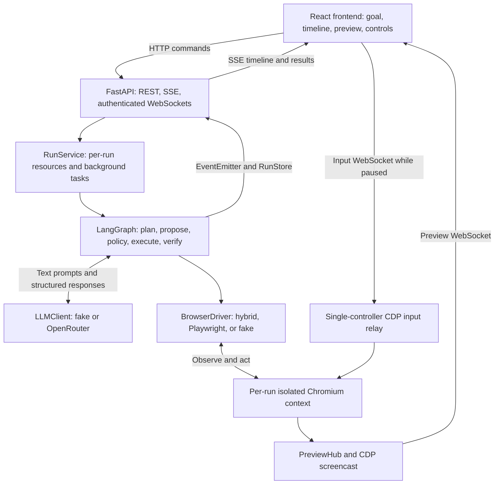
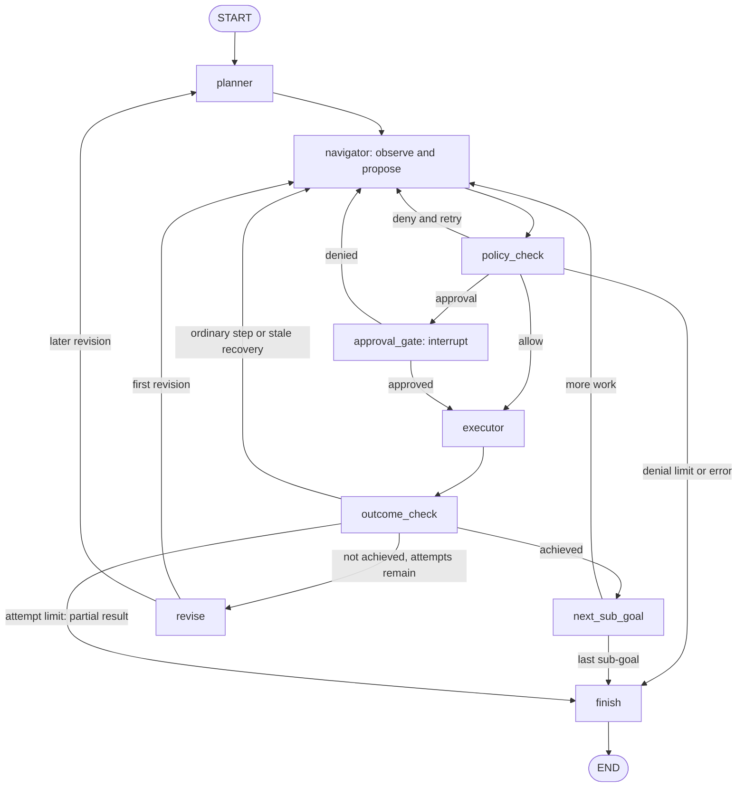

# Architecture

## 1. What this app does

**Clevis / Web Task Orchestrator** lets a user describe a browser task in plain English, watch an agent work in a live preview, and take control when a human step is needed. The user can set permissions, approve or deny proposed actions, stop execution, and resume the agent after completing a login, CAPTCHA, or similar obstacle.

A run consists of a plan and a sequence of browser actions. The agent reads a compact text representation of the current page, proposes one structured action, passes it through a deterministic policy engine, and executes it. An LLM-based outcome checker verifies completed sub-goals. Failed checks can trigger a retry or a revised plan; the run can also return a partial result.

This is a local, single-process application with a React frontend and an asynchronous Python backend. It has no application database, user-account system, or durable job queue. Browser sessions and backend execution state are owned by the running API process.

The code supports two independent choices:

- **Model:** scripted fake responses or a real model accessed through OpenRouter.
- **Browser:** the default PinchTab/Playwright hybrid, the explicit Playwright-only path, or a fake browser with generated preview frames.

Defaults and runtime modes are explained in [Configuration](#7-configuration-and-environment-variables). A fake model can control a real browser; fake-model tests are not simulations of the browser itself.

## 2. System overview



There are three separate data channels. **SSE carries progress**, the **preview WebSocket carries images**, and the **input WebSocket carries human input**. Frames and takeover keystrokes do not travel through the agent event stream. The LLM normally receives text observations, not the preview images.

### Technology and process boundaries

| Part | Implementation | Responsibility |
|---|---|---|
| Frontend | React 19, JavaScript/JSX, Vite 6, Tailwind 4 | Goal entry, permissions, activity display, approval modal, canvas preview, takeover controls. |
| API | Python 3.11+, async FastAPI, Uvicorn, pydantic v2 | Validate requests, create and control runs, stream events and browser output. |
| Agent orchestration | LangGraph **1.2.17**, pinned in `pyproject.toml` | Conditional workflow, serializable state, in-memory approval checkpoints. |
| Model access | Official `openai` Python SDK configured for OpenRouter | Planner, actor, and outcome-verifier requests; retries, output validation, usage accounting. |
| Browser ownership | Playwright for Python **1.64.0**, Chromium only | Launch, isolated contexts, active tabs, navigation protection, cleanup, CDP access. |
| Default agent browser adapter | Local authenticated PinchTab **0.15.2**, with Playwright checks | Interactive snapshots and supported actions against the browser Playwright owns. |
| Preview/input | Separate Playwright CDP sessions | Screencast capture and human mouse/key/text dispatch. |
| Persistence | Python memory; browser `localStorage` for UI history | No SQL, Redis, external checkpoint database, or backend history database. |

Node/npm is used for frontend tooling, not an application backend. LangGraph brings `langchain-core` and LangSmith transitively; the app does not use LangChain chains or agent integrations. `runner.py` explicitly disables automatic external tracing around execution.

## 3. Repository and main files

```text
.
├── ARCHITECTURE.md          # This implementation guide
├── AGENTS.md                # Repository development and security instructions
├── README.md                # Local startup entry point
├── backend/
│   ├── pyproject.toml       # Python package, dependencies, pytest/Ruff/mypy settings
│   ├── uv.lock              # Resolved dependency lockfile for uv
│   ├── .env.example         # Non-secret configuration template
│   ├── README.md            # Detailed setup, protocols, behavior and limitations
│   ├── app/
│   │   ├── main.py          # FastAPI composition and lifespan
│   │   ├── config.py        # Typed environment settings
│   │   ├── runtime.py       # RunService and resource/task ownership
│   │   ├── logging.py       # Structured logging and transport privacy filters
│   │   ├── api/             # HTTP, SSE and WebSocket endpoints
│   │   ├── core/            # Events, lifecycle, store, emitter, budgets, redaction
│   │   ├── interfaces/      # Injectable browser/model/policy/skills contracts
│   │   ├── agent/           # Graph, nodes, prompts, execution and policy
│   │   ├── browser/         # Real drivers, observation, navigation and input privacy
│   │   ├── llm/             # OpenRouter client and process-wide SDK pool
│   │   ├── preview/         # Capture, fan-out, framing and input relay
│   │   └── fakes/           # Scripted model and browser implementations
│   └── tests/               # Unit, browser, API, privacy and evaluation tests
├── front end/               # Actual frontend directory name contains a space
│   ├── package.json
│   ├── package-lock.json
│   ├── index.html
│   ├── vite.config.js
│   ├── vitest.config.js
│   └── src/
│       ├── main.jsx
│       ├── WebTaskOrchestrator.jsx
│       ├── hooks/
│       ├── components/
│       ├── preview/
│       ├── constants/
│       ├── lib/
│       └── index.css
├── testsite/                # Static fake-data pages for browser exercises
├── scripts/                 # Local service, spike, audit and process-check utilities
├── docs/                    # Discovery, protocol notes, verification and acceptance reports
├── .ruff.toml               # Root lint settings extending the backend configuration
├── .gitignore               # Local secrets/generated-file exclusions
└── pyrightconfig.json       # Editor Python analysis configuration
```

`__init__.py` files mark Python packages. Virtual environments, caches, `node_modules/`, and frontend `dist/` are generated/local material rather than application architecture. Protected environment-owned directories are not application modules. Root `.ruff.toml` extends the backend lint rules and excludes generated environments/builds; `.gitignore` files protect local configuration and artifacts. `pyrightconfig.json`, frontend `jsconfig.json` and UI `components.json` support editor/tooling configuration.

### Backend entry points and contracts

Paths below are relative to [`backend/app/`](backend/app/).

| File | What it does |
|---|---|
| `main.py` | Exposes `app = create_app()`. Includes routers, configures CORS and JSON error handlers, validates model settings, checks PinchTab when selected, opens the real SDK pool, and shuts down tasks/resources. Factories can be injected for tests. |
| `config.py` | Defines `Settings` through pydantic-settings. Reads environment variables and the working-directory `.env`; validates domain configuration and real-model prerequisites. |
| `runtime.py` | `RunService` creates runs, resolves permissions, enforces concurrency admission, constructs per-run dependencies/tokens/hubs, tracks asyncio tasks, and implements Stop, takeover, resume, approval decisions, and timeout watchers. |
| `logging.py` | Emits a small structured metadata whitelist and filters transport DEBUG output that could contain WebSocket payloads. |
| `api/runs.py` | REST request/response schemas, run creation/state/control, authenticated approve/deny, and replayable SSE. |
| `api/preview.py` | Preview WebSocket authentication, Origin check, viewer subscription, frame/status delivery and heartbeats. |
| `api/ws.py` | Input WebSocket authentication, controller acquisition, validation/rate limits, accepting-state checks and relay cleanup. |
| `core/events.py` | Pydantic action/plan/event schemas, event type enum, envelope and typed data variants. |
| `core/state.py` | `RunRecord`, `RunStatus`, explicit legal-transition table, pause/active-time bookkeeping, cancellation/approval coordination, and transition events. |
| `core/store.py` | `RunStore` protocol and lock-protected `InMemoryRunStore`; assigns/stores ordered event sequences and returns copies. |
| `core/emitter.py` | `EventEmitter` protocol and `FanoutEventEmitter`; stores events before delivering them to per-run SSE subscriptions, coordinating replay with live delivery. |
| `core/budgets.py` | Limits and usage counters, token/cost accumulation, limit errors and `budget.update` data. Step limits are also enforced by the navigator. |
| `core/privacy.py` | Shared conservative text redactor, also used for public started-goal text and prompts. |
| `interfaces/browser.py` | `BrowserDriver`, `PreviewChannel`, observation/element/action-result models, and optional guard/navigation/pause hook protocols. |
| `interfaces/llm.py` | `LLMClient`, messages, parsed responses, usage and typed LLM exceptions. |
| `interfaces/validator.py` | `ActionValidator`, state-aware/network-policy protocols, verdicts and legacy `AllowAllValidator`. Production `RunService` injects `PolicyValidator`. |
| `interfaces/skills.py` | `SkillProvider` and `EmptySkillProvider`. There is no implemented skill library. |

### Agent implementation: where the agent and validators live

| File | What it does |
|---|---|
| `agent/runner.py` | Lifecycle bridge into the compiled graph. Starts the browser/preview, installs navigation protection, sets per-run context, starts graph streaming, waits for approval decisions, resumes via `Command`, and owns final cleanup. It does not forward LangGraph chunks to the frontend. |
| `agent/graph.py` | Builds the module-level graph and attaches the in-memory `MemorySaver` checkpointer. |
| `agent/routing.py` | Pure conditional edge functions: next action, approval, retry, revision, next sub-goal or finish. |
| `agent/state.py` | Serializable pydantic `AgentState`, `SubGoal`, `StepRecord`, `OutcomeVerdict` and `BudgetState`. Stores safe projections and value hashes rather than the private executable action value. |
| `agent/context.py` | Task-local `RunContext` via `ContextVar`. Holds injected live objects and transient private action/observation data outside checkpoints; sanitizes state/history and wraps node execution. |
| `agent/execution.py` | Shared cancellation/pause gates, in-flight operation tracking, budget checks and sanitized event/result publication. |
| `agent/steps.py` | Small planning, observation, proposal, validation, action and completion helpers; includes verification-obstacle handoff handling. |
| `agent/prompts.py` | Trusted planner/actor rules and user messages. Website content and action feedback go inside random untrusted delimiters, not system instructions. |
| `agent/outcomes.py` | **LLM outcome validator:** constructs the bounded verifier prompt, parses the verdict, accounts for usage and retries invalid output once. |
| `agent/revisions.py` | Builds short, safe planner feedback using fixed categories rather than copying arbitrary page-derived text. |
| `agent/loops.py` | Observation fingerprint/no-progress helpers; graph nodes also track repeated action signatures. |
| `agent/checkpoints.py` | Deletes terminal checkpoint history and pending writes, then retains a sanitized terminal diagnostic summary. |
| `agent/version.py` | `LANGGRAPH_TESTED_VERSION` constant. |
| `agent/policy/validator.py` | **Deterministic policy validator:** combines risk classification, domains, SSRF checks, permissions, credential provenance and data flow into allow/approval/deny decisions. No LLM call. |
| `agent/policy/tiers.py` | Ordered tier rules and per-run capability denials, using action/element/form/page metadata. |
| `agent/policy/domains.py` | Exact-host domain parsing, blocked/allowed checks and IP/metadata-address classification with an injected resolver. |
| `agent/policy/resolver.py` | Asynchronous per-run DNS lookup/cache feeding the pure address checks. |
| `agent/policy/dataflow.py` | SHA-256 fingerprints, source domains and byte lengths for extracted data; flags matching text typed on another domain without retaining that text. |
| `agent/policy/permissions.py` | Request/effective permission models and merging/ceiling validation against server defaults. |
| `agent/policy/approvals.py` | Atomic approval-decision queueing, bound-ID/duplicate checks and safe denial-reason categorization. |

The nine graph node files are in `agent/nodes/`:

| Node file | Responsibility |
|---|---|
| `planner.py` | Ask the model for a plan, construct sub-goals, preserve completed work on re-entry and emit `plan.created`. Current success conditions derive from the plan step text. |
| `navigator.py` | Observe, propose one action, count usage/steps, detect repeated actions and emit observation/proposal/budget events. Does not execute the action. |
| `policy_check.py` | Call the injected validator; emit `step.validated`; count consecutive denials; generate an approval UUID and emit `approval.required` when needed. |
| `approval_gate.py` | Pause with `interrupt()` and accept the resumed approved/denied decision. This is separate from browser takeover. |
| `executor.py` | Execute an allowed action, handle `done`/`handoff`, hash extraction data, record results, and apply bounded stale/invalid-action recovery. |
| `outcome_check.py` | Check progress and, at sub-goal completion/step-cap boundaries, call the outcome verifier and add its usage. |
| `next_sub_goal.py` | Advance and reset sub-goal counters after success. |
| `revise.py` | Increment revision attempts, force a fresh observation and emit an internal `revise` timeline proposal; route to retry or replanning. |
| `finish.py` | Commit terminal state/results; close successful browser/preview resources while respecting pause/resume races. |

Nodes perform the required injected I/O. The **routing functions**, not the effectful nodes, are pure functions.

### Browser, model and preview files

| File | What it does |
|---|---|
| `browser/factory.py` | Selects hybrid PinchTab first when `AGENT_DRIVER=pinchtab`; otherwise selects real Playwright or the fake browser through `BROWSER_DRIVER`. |
| `browser/playwright_driver.py` | Chromium launch/context ownership, active-page/popup tracking, dialog dismissal, observe/act, ref generation, navigation interception/guards, pause hooks and cancellation-safe cleanup. |
| `browser/observe.js` | JavaScript evaluated **inside the browser page**, not a Node server. Extracts visible main-frame interactive elements, accessible-name approximations, state and bounded visible text; filters hidden content and redacts secret fields. |
| `browser/safety.py` | URL scheme validation, secret-pattern helpers and headed-display checks. |
| `browser/network.py` | Independent browser-side destination/redirect checks, including fresh post-navigation DNS checks and approved-host handling. |
| `browser/input_privacy.py` | Transient-input fingerprinting/scrubbing so takeover text does not become an agent observation or public result. |
| `browser/pinchtab_driver.py` | Playwright-owned hybrid browser: attaches PinchTab, reconciles its refs with the safe Playwright observation, and executes supported actions with freshness/visibility checks. |
| `browser/pinchtab_api.py` | PinchTab version constants, loopback validation, HTTP endpoints, snapshot parsing, operation deadlines and sanitized error mapping. |
| `llm/openrouter_client.py` | Shared `AsyncOpenAI` pool plus per-run clients; catalog capability/pricing cache, schema/JSON output handling, retries/fallback model, safe errors, cancellation and usage/cost accounting. |
| `fakes/fake_llm.py` | Scripted planning/actions/verifier responses for tests and fake mode. |
| `fakes/fake_driver.py` | Canned observations/actions and injectable delays/failures without a real browser. |
| `preview/factory.py` | Selects CDP capture/input for Playwright-derived drivers, including the hybrid; otherwise selects fake capture. |
| `preview/cdp.py` | Screencast supervision, frame acknowledgements, throttling, decode/publish, reattach, native-size validation and screenshot fallback. Coordinates HiDPI capture/input geometry during takeover. |
| `preview/hub.py` | In-memory latest frame, stream status, bounded viewer queues, idle resend and final-frame retention. |
| `preview/framing.py` | Frame metadata model and binary length-prefix encoder/decoder. |
| `preview/control.py` | Single-controller ownership, input readiness, activity/counters and relay release. |
| `preview/input_protocol.py` | Validated auth/mouse/wheel/key/text/ping messages, limits and rate limiter. |
| `preview/input_relay.py` | Separate active-page CDP input session; coordinate clamping, button/key mapping, text insertion and pressed-input cleanup. |
| `preview/fake.py` | Generates JPEG test-pattern frames with Pillow, in memory. |

### Frontend main files

Paths are relative to [`front end/`](<front end/>).

| File | What it does |
|---|---|
| `index.html`, `src/main.jsx` | Browser document/root and React bootstrap. The HTML also requests Google Fonts CSS. |
| `src/WebTaskOrchestrator.jsx` | Composes the screen and owns drawer/developer-panel/command-panel visibility. Connects hook state to all major components. |
| `src/hooks/useTaskOrchestrator.js` | Owns run/form/history state, constructs run requests, consumes streamed SSE, handles Stop/takeover/resume, and submits authenticated approval decisions. |
| `src/components/Header.jsx`, `StatusPill.jsx`, `ConstellationLogo.jsx` | Header navigation, status and branding. |
| `src/components/AssistantConsole.jsx` | Goal/command entry and run controls; connects optional permissions and attachments. |
| `src/components/PermissionsPanel.jsx` | Collapsed advanced permissions; validates explicit overrides and omits unchanged defaults from the request. |
| `src/components/ApprovalDialog.jsx` | Safe approval summary/risk/domain, approve/deny, pending/expired UI and reachable Stop. |
| `src/components/ViewportCanvas.jsx` | Browser-workspace container and idle templates; hosts `LivePreview` and task activity. It is not the browser automation driver. |
| `src/components/TaskActivityPanel.jsx`, `IntentPanel.jsx`, `TelemetryLedger.jsx` | User activity/plan/result display and developer-facing inspection panels. |
| `src/components/HistoryDrawer.jsx` | Local history display, reuse and clearing; does not recover server-side browser sessions. |
| `src/components/AttachmentTray.jsx` | Displays locally selected `File` objects. There is no attachment upload endpoint in this implementation. |
| `src/components/ui/` | Reusable button, prompt input, textarea and tooltip primitives. |
| `src/preview/LivePreview.jsx` | Authenticates/reconnects preview WS, schedules latest-only image drawing on a correctly sized canvas, and displays status/debug/takeover overlays. |
| `src/preview/protocol.js` | Preview WebSocket URL, binary packet decoding and native/CSS sizing calculations. |
| `src/preview/image.js` | Image decoding with bitmap/object-URL fallback and resource cleanup. |
| `src/preview/useInputControl.js` | Opens input WS only during control, authenticates, captures preview/editor input and clears transient typed text after sending. |
| `src/preview/input.js` | Pure coordinate, modifier, key/shortcut, wheel, click-count and text-chunking helpers. |
| `src/constants/theme.js`, `src/index.css`, `src/lib/utils.js` | Theme/templates, styles/local font imports and CSS utility composition. `BACKEND_URL` is currently a code constant set to an empty same-origin prefix. |
| `vite.config.js` | Development server on port 5173, strict port selection, React/Tailwind plugins, alias and `/api` HTTP/WS proxy to `127.0.0.1:8000`. |
| `vitest.config.js`, `src/**/*.test.*` | Frontend tests for requests, approvals, permissions, framing/sizing, input and components. |
| `package.json`, `package-lock.json` | Frontend commands/dependencies and npm lockfile. `components.json` and `jsconfig.json` configure UI tooling/editor aliases. |

### Tests, scripts and documentation

| Location | Purpose |
|---|---|
| `backend/tests/test_*.py` | Schema/state/store, model transport mocks, graph/policy/approval, browser, preview, input, privacy and real HTTP regression coverage. |
| `backend/tests/conftest.py`, `settings.py` | Local static-site fixtures, isolated settings, browser lifecycle and existing opt-in markers. |
| `backend/tests/browser_demo.py`, `preview_demo.py`, `takeover_ui_demo.py`, `scripted_browser_llm.py`, `smoke_cases.py`, `event_sequences.py` | Shared scripted-browser/UI test harnesses, smoke definitions and expected event helpers. |
| `backend/tests/fixtures/` | Sanitized PinchTab sample payloads. |
| `backend/tests/eval/` | Scenario harness, recorder and policy/outcome/approval/revision/SSRF categories; live-model scenarios require explicit opt-in. |
| `testsite/` | `index`, `form`, `login`, `table`, `long`, `popup`, `hidden-text`, `injection-visible`, `ssrf-redirect` and `eval-dataflow` HTML pages with fake data; shared `site.js`/`site.css`. Redirect/injection pages are deliberate security fixtures. |
| `scripts/serve_testsite.py` | Standard-library static server, default loopback port 8765. |
| `scripts/run_pinchtab.py` | Launches the installed tested binary with token auth, loopback-only attach and disposable configuration/state. Reads the exported token, not the backend `.env`. |
| `scripts/spike_pinchtab_attach.py` | Standalone versioned attach/coexistence experiment with checks, measurements and cleanup. |
| `scripts/check_no_leftover_processes.py`, `process_audit.py` | Mixed lifecycle/concurrent-run checks, owned-process tracking and RSS measurement. |
| `scripts/audit_repo.py` | Credential-pattern/history and settings/example parity checks; emits paths/counts rather than secret values. |
| `docs/discovery-report.md` | Historical discovery/removal baseline; describes an earlier backend/frontend and is not the current implementation reference. |
| `docs/smoke-tasks.md`, `docs/phase2-notes.md` | Five fake-site goals/expectations and extension boundaries for later phases. |
| `docs/*verification*.md`, `*acceptance*.md`, `*pr-description*.md`, protocol/spike/recovery notes | Dated implementation evidence, human checks, decisions and operational details. Historical gate counts are not a new test result. |
| `docs/eval-results.json`, `docs/phase2-eval-report.md`, `docs/assets/` | Test/evaluation artifacts and reports. JSON records contain scenario identifiers, booleans and counters, not production page/frame payloads. |

## 4. End-to-end flow: submitting a browser task

### 4.1 Frontend submission and API admission

1. The user enters a goal in `AssistantConsole`. Advanced permissions are optional and initially collapsed. The optional starting URL becomes a `Start at: ...` instruction appended to the goal; it is not a separate API field.
2. `useTaskOrchestrator.runTask()` resets the displayed run state and calls `POST /api/runs` with `{goal, mode: "headless", permissions?}`. The current frontend always requests headless mode; headed mode is available to API clients. Attachments and legacy UI timeout/step state are not independently sent as backend run fields; explicit limits come through permission overrides.
3. FastAPI validates the trimmed goal (1–2000 characters), mode and permissions. Effective domains/capabilities/ceilings are resolved from server defaults plus the request. Invalid requests return the shared JSON error envelope.
4. `RunService` admits the run under its concurrency lock (default three active runs, including paused runs). It creates a `RunRecord`, per-run state machine, browser/model dependencies, preview hub and control session.
5. Three independent random capabilities are generated: `previewToken`, `controlToken`, and `approvalToken`. The response is **201** with those capabilities and `runId`. The browser need not already be ready when that response arrives.
6. The service starts one tracked asyncio background task. The frontend retains the capabilities in memory, subscribes to `/events`, and connects the preview WebSocket.

### 4.2 Browser setup and agent graph

The runner enters planning, starts the selected browser, installs the independent policy/navigation guards, starts preview capture, and initializes `about:blank`. The injected skill provider currently returns no skills. Dependencies live in a task-local context; the serializable graph state uses `thread_id = run_id`.



This diagram shows normal routing; cancellation, takeover epochs and errors can interrupt any node.

- **Planner:** sees the goal and optional revision feedback, not website page content. Produces plan steps that become sub-goals; completed work survives replanning.
- **Navigator:** reads a fresh observation and sends the goal, current sub-goal, bounded history, remaining budget and delimited page data to the model. The response is validated as one action. It emits `observation.summary`, `step.proposed` and budget updates.
- **Policy:** evaluates deterministic rules before execution. Tier 0/1 allows ordinary read/interaction; Tier 2 requests human approval; Tier 3 denies. Per-run disabled capabilities can deny actions. Three consecutive denials on the same sub-goal fail the run.
- **Executor:** uses the private action value from `RunContext`; checkpoint/public action projections do not carry raw typed values. It records `step.executed` and safe history. Stale/not-found and invalid-action recovery are bounded and return to a fresh observation.
- **Outcome checker:** its node runs after execution, but an LLM call happens only when a sub-goal proposes a successful nonempty `done` or hits its step cap. The prompt includes at most 50 elements, three step summaries and a short text excerpt inside an untrusted block. The dedicated model session caps output at 80 tokens, validates the verdict and retries invalid output once.
- **Revision/finish:** failed verification retries/replans within configured revision limits, then can finish with an explanatory partial result. A `run.finished` event therefore does not necessarily mean every sub-goal succeeded; read its result. Unexpected errors produce `run.failed`.

The action schema supports `navigate`, `click`, `type`, `scroll`, `extract`, `wait`, `done`, and `handoff`. `revise` is reserved for the internal timeline and rejected as an actor-proposed browser action. `type` with no target and a recognized key value implements key presses such as Enter.

### 4.3 Browser observation and execution

A real driver owns a fresh isolated Chromium context per run, with downloads disabled and no granted permissions. It tracks the active page when tabs/popups open or close, dismisses JavaScript dialogs, and closes its resources on completion/cancellation.

For the default hybrid:

1. Playwright launches Chromium with a loopback debugging endpoint; PinchTab attaches to that owned browser.
2. `observe()` first obtains Playwright's visible/redacted DOM observation. PinchTab supplies an interactive snapshot of the same active tab.
3. The driver reconciles unambiguous role/name matches and maps safe element refs to PinchTab refs. It retains the Playwright observation's visibility, redaction and size limits rather than exposing unfiltered snapshot values.
4. Before a ref action, it checks the page/navigation epoch, re-snapshots PinchTab and rechecks visibility/freshness. Supported actions go through the local API; extraction uses the safe observation text.
5. PinchTab outages/version/auth failures fail clearly. The driver does not silently switch implementations mid-run.

The Playwright-only path uses the evaluated DOM script and Playwright locators directly. Both paths produce the same `Observation`/`ActionResult` interface. Observations use main-frame DOM elements and bounded text, not full HTML or a screenshot. Refs belong to the latest observation and must not be reused after a page/generation change.

Because the hybrid still takes a Playwright observation and performs reconciliation, it is not guaranteed to reduce model tokens, latency or browser work compared with Playwright alone.

### 4.4 Timeline, preview, approval and takeover

**Timeline:** nodes/state transitions publish through `EventEmitter`. The store assigns a gap-free per-run sequence; subscriptions replay missed events then continue live. The frontend maps plan, rationale, observation, execution, budgets and terminal events into UI state. The server supports replay, but the current frontend fetch consumer does not automatically reconnect/replay SSE after a lost connection.

**Preview:** a separate CDP session starts `Page.startScreencast`. Frames are acknowledged before throttling/decoding; encoded bytes are passed through without server resizing/re-encoding. The hub keeps the latest image and bounded per-viewer queues, dropping oldest frames for slow viewers. Capture reattaches on tab/navigation/session changes; screenshot polling provides a low-frame-rate JPEG fallback. Idle resend distinguishes a static page from a dead stream. Final-frame retention starts after run cleanup.

The frontend decodes the frame envelope, draws only the latest pending image through `requestAnimationFrame`, and sets canvas internal dimensions to frame pixels. CSS fits the native CSS size within the container without upscaling. Hidden tabs defer drawing. Development debug output requires a dev build and `?debug=1` or `VITE_PREVIEW_DEBUG=1`.

**Policy approval:** the policy node creates a UUID `approval_id`, emits `approval.required`, and pauses at `interrupt()`. The modal shows only the safe action summary, risk and domain. Approve/deny submits the ID with the separate bearer capability. The service checks the current checkpoint/ID, atomically queues one decision, and the original runner resumes its graph with `Command(resume=...)`. Approval executes the pending action; denial records safe feedback and re-proposes. Approval timeout fails the run. The ordinary takeover `/resume` endpoint cannot approve a policy action.

**Takeover/handoff:** the user presses Take over, or the actor proposes `handoff`. The service pauses/cancels in-flight agent work, sets the browser pause flag and enables one authenticated controller. Pointer coordinates map from the displayed canvas rect to viewport-relative CSS pixels, without adding page scroll offsets. A separate CDP session dispatches mouse/wheel/key events and `Input.insertText`; hidden-editor text is cleared after transmission. HiDPI capture/input readiness is synchronized before relaying input. The agent does not call the browser/model while paused. Resume closes the controller session and forces a fresh observation before the next proposal. A socket drop frees controller ownership but leaves the agent paused until resume, Stop or timeout.

**Termination:** Stop sets cancellation and cancels the same background task, including in-flight model/browser work. Cleanup closes preview, browser and per-run model sessions, releases the controller and joins watchers. The shared SDK pool closes at application shutdown. Terminal checkpoint history is replaced by a sanitized diagnostic summary; the preview's final image expires independently. Losing a preview viewer alone does not stop the run.

## 5. Public API and stream contracts

### REST

| Method/path | Purpose |
|---|---|
| `GET /health` | API liveness response `{status: "ok"}`; not a continuous provider/browser health test. |
| `POST /api/runs` | Create with `goal`, `mode` and optional `permissions`; returns 201 and run ID/three capabilities. |
| `GET /api/runs/{id}` | Current status, goal/mode, result/error, creation time and resolved permissions. |
| `GET /api/runs/{id}/events` | Replayable SSE. `?after=` overrides `Last-Event-ID`. Keep-alive comment every 15 seconds; ends after a terminal event. |
| `POST /api/runs/{id}/stop` | Stop a non-terminal run; repeated Stop on an already stopped run is idempotent. Other terminal states conflict. |
| `POST /api/runs/{id}/takeover` | Pause a running agent for user control; idempotent for the same takeover pause. |
| `POST /api/runs/{id}/resume` | Release takeover/handoff and continue; not a policy-approval decision. |
| `POST /api/runs/{id}/approve` | Body `approval_id`; requires `Authorization: Bearer <approvalToken>`. |
| `POST /api/runs/{id}/deny` | Same auth/ID, optional reason of at most 200 characters. |

Errors use `{error: {code, message}}`. Relevant statuses include 404 unknown run, 409 invalid transition/duplicate decision, 422 invalid/stale input, 401 approval authorization, and 429 concurrency admission. There is no list-runs, account, database-history, attachment-upload or file-download API.

Every timeline event has `{runId, seq, ts, type, data}`. Types are `run.started`, `plan.created`, `observation.summary`, `step.proposed`, `step.validated`, `step.executed`, `budget.update`, `approval.required`, `run.paused`, `run.resumed`, `run.finished`, `run.failed`, and `run.stopped`. `step.validated` and `approval.required` were reserved in the original foundation and are emitted by the current policy workflow. Timeline rationale is short structured text, not raw model chain-of-thought.

### WebSockets

Both sockets require the configured `Origin` and a first JSON auth message, with the capability in the message body rather than the URL. Unknown runs close with 4404, missing/invalid auth with 4401, and disallowed Origin with 4403. Only the input socket enforces single-controller ownership (4409 on conflict).

| Socket | Messages |
|---|---|
| `/api/runs/{id}/preview` | Client: auth and ping. Server: status/ping/pong JSON and binary frames. Statuses: waiting, live, stalled, fallback, ended. Multiple read-only viewers allowed. |
| `/api/runs/{id}/input` | Client: auth, mouse, wheel, key, text, ping. Server: accepting/controller state with input limits, pong and fixed error codes. Invalid payloads count toward a 50-reject close (4400); rate-limited excess is dropped. |

Preview binary framing is `[4-byte big-endian JSON byte length][UTF-8 JSON metadata][encoded image bytes]`. Metadata includes format, frame width/height, device scale, CSS viewport width/height, page scale, scroll offsets, offsetTop, sequence, timestamp and tab ID. Input uses viewport CSS coordinates, not image pixels or page coordinates. See [the backend README](backend/README.md) for protocol examples and decoding details.

## 6. External services and data storage

### External connections

| Service/dependency | When used | Interface and boundary |
|---|---|---|
| OpenRouter | Only when `LLM_PROVIDER=openrouter` | Backend `AsyncOpenAI` uses `OPENROUTER_BASE_URL` (default `https://openrouter.ai/api/v1`), model catalog lookup and chat completions. Key stays on the backend. Catalog capability controls schema mode; unsupported/unknown capability falls back to JSON-only prompting/parsing. Model fallback/retry is client-controlled. |
| PinchTab | When `AGENT_DRIVER=pinchtab` | Local HTTP bearer-auth service, default `http://127.0.0.1:9867`; exact tested version and anonymous rejection are checked at startup. Adapter uses `/health`, `/instances`, `/instances/attach`, instance/tab mapping and stop, and tab snapshot/action/navigation/handoff/resume endpoints; attached tab traffic can use the returned validated loopback bridge. Extraction uses the safe observation rather than a raw text endpoint. Not exposed directly to the frontend. |
| Chromium/CDP | Real browser modes | Local Playwright transport plus separate CDP sessions for capture/input/navigation interception. The hybrid's debugging endpoint is loopback-only. No separate remote browser SaaS is configured. |
| Target websites and DNS | Real browser tasks | Chromium contacts the requested sites; policy and browser checks govern destinations. Page data is untrusted. Login/CAPTCHA success depends on the target site and human handoff. |
| Google Fonts | Frontend document load | `front end/index.html` requests CSS/assets from `fonts.googleapis.com`/`fonts.gstatic.com`; local Geist font imports also exist. No app credential involved. |
| Package registries/browser downloads | Installation/build | pip/uv, npm and `playwright install chromium`; these are setup dependencies, not application APIs. |

The real model adapter reuses one SDK connection pool per application lifespan and returns per-run sessions. It validates JSON with pydantic, retries transient errors with backoff/Retry-After, supports an optional fallback model and sanitizes auth/transport failures. Usage includes planner, actor, verifier and retry calls. Missing provider cost is estimated from catalog pricing (with an estimated flag); local budget accounting is not a provider-side billing guarantee. No OpenRouter key or model ID is hardcoded into the frontend.

### Storage and lifetime

| Data | Where it lives | Lifetime/behavior |
|---|---|---|
| Run records/events | `InMemoryRunStore` in the API process | Protected by asyncio locks; lost on restart. Completed runs have no general historical TTL. |
| Graph checkpoints | Process-wide `MemorySaver`, keyed by run ID | JSON-compatible safe projections; terminal history/pending writes are deleted and a sanitized terminal summary retained. No cross-process live-browser recovery. |
| Private executable action/raw observation | Per-task `RunContext`/execution helpers | Transient RAM used by model/browser calls, outside checkpoint state. Cleared/released at terminal cleanup. |
| Data-flow provenance | Serializable hash-keyed graph data | Hashes, source domains and byte lengths; no extracted value retained by the tracker. |
| Preview/control/approval capabilities | Backend dictionaries and frontend memory | Per-run capabilities; not placed in URLs or persistent frontend storage. Backend capability dictionaries clear on shutdown. |
| Latest frame/viewer queues | `PreviewHub` RAM | Bounded viewer queues; latest frame retained for configured post-end interval, then discarded. Not stored in run events or database. |
| Cookies/site state | Per-run isolated browser context | No shared/persistent profile; destroyed when browser resources close. |
| UI history | Browser `localStorage`, key `wto_history` | Up to 50 task/URL/status/step/result-summary records. Survives page reload; Clear History removes it. No backend synchronization and no capability fields. |
| Attachments | Frontend memory as browser `File` objects | Local selection only; no upload in the current run request. |
| Evaluation results | `docs/eval-results.json` | Test-generated, append-only scenario identifiers, statuses, assertions and numeric counters/costs. Not the production run store. |

There is no configured SQL/NoSQL database, ORM, migration system, Redis/Celery queue or external checkpoint backend. In-memory ownership means one API worker is the supported deployment shape; multiple workers would not share run IDs, tasks, browser objects or subscriptions.

## 7. Configuration and environment variables

[`backend/app/config.py`](backend/app/config.py) is the source of typed **code defaults**; [`backend/.env.example`](backend/.env.example) is a template. Environment overrides take priority over `.env`. The file path is relative to the process working directory, so documented API commands run from `backend/`. Secrets must be configured privately; no local `.env` values were read to write this document.

Some class defaults are deliberately not an entire ready-to-run profile. In particular, `AGENT_DRIVER` defaults to PinchTab and therefore requires the local service, while `LLM_PROVIDER` defaults to fake. `BROWSER_DRIVER` defaults to fake in code but is set to playwright in `.env.example`.

| Desired runtime | Selectors |
|---|---|
| Real hybrid browser and model | `AGENT_DRIVER=pinchtab`, `LLM_PROVIDER=openrouter`; authenticated PinchTab plus key/model configured. |
| Real browser without PinchTab | `AGENT_DRIVER=playwright`, `BROWSER_DRIVER=playwright`; choose fake or OpenRouter model independently. |
| No browser/server/model dependency demo | `AGENT_DRIVER=playwright`, `BROWSER_DRIVER=fake`, `LLM_PROVIDER=fake`; use the explicit fake-demo prefix in README, including its development-only network setting. |

`BROWSER_DRIVER` does not override the hybrid when `AGENT_DRIVER=pinchtab`. `USE_FAKES` is a retained compatibility setting, not the factory switch; the selectors above control runtime behavior. `BROWSER_HEADLESS` is also retained, but `start(mode)` uses the run's explicit mode; the frontend sends headless.

The tables below list all backend Settings variables. Defaults are from code, not a developer's private environment.

### Application, browser and budgets

| Variable | Code default | Purpose |
|---|---|---|
| `FRONTEND_ORIGIN` | `http://localhost:5173` | Only allowed CORS origin and expected WebSocket Origin. |
| `LOG_LEVEL` | `INFO` | Application structured log level. |
| `AGENT_DRIVER` | `pinchtab` | Hybrid selection or explicit `playwright` alternative. |
| `BROWSER_DRIVER` | `fake` | With Playwright agent selector: fake or real Playwright browser. |
| `BROWSER_HEADLESS` | `true` | Compatibility setting; per-run mode determines actual launch. |
| `USE_FAKES` | `true` | Compatibility setting; not the active model/browser selector. |
| `VIEWPORT_WIDTH` | `1280` | Browser viewport CSS width. |
| `VIEWPORT_HEIGHT` | `720` | Browser viewport CSS height. |
| `DEVICE_SCALE_FACTOR` | `1` | Browser device scale and native frame sizing. Scale 2 has about four times the pixels. |
| `NAV_TIMEOUT_MS` | `20000` | Navigation deadline. |
| `ACTION_TIMEOUT_MS` | `8000` | Browser action deadline. |
| `MAX_OBSERVED_ELEMENTS` | `150` | Interactive element cap per observation. |
| `MAX_OBSERVED_TEXT_CHARS` | `3000` | Visible text/extraction cap. |
| `SLOW_MO_MS` | `0` | Optional Playwright operation slowdown for inspection. |
| `MAX_CONCURRENT_RUNS` | `3` | Active per-process run admission limit, including paused runs. |
| `MAX_STEPS` | `30` | Global action budget/default run ceiling. |
| `MAX_SECONDS` | `300` | Active execution time budget, excluding pauses. |
| `MAX_TOKENS` | `200000` | Combined model prompt/completion token budget. |
| `MAX_COST_USD` | `0.50` | Local model-cost budget; 0 disables the global cost ceiling. |
| `MAX_HISTORY_STEPS_IN_PROMPT` | `8` | Detailed history bound used by graph/prompt context. |
| `SUBGOAL_MAX_STEPS` | `8` | Step cap before checking a sub-goal outcome. |
| `SUBGOAL_MAX_ATTEMPTS` | `2` | Revision limit after unsuccessful verification; current semantics count revisions after the initial attempt. |

### Model service and local PinchTab

| Variable | Code default | Purpose |
|---|---|---|
| `LLM_PROVIDER` | `fake` | Scripted model or `openrouter`. |
| `OPENROUTER_API_KEY` | unset | Backend secret, required for OpenRouter mode. |
| `OPENROUTER_BASE_URL` | `https://openrouter.ai/api/v1` | OpenAI-compatible API base URL. |
| `LLM_MODEL_PRIMARY` | unset | Required model identifier for real mode. |
| `LLM_MODEL_FALLBACK` | unset | Optional alternate model after eligible primary failures. |
| `LLM_OUTCOME_MODEL` | unset | Verifier model; defaults to primary when empty. Dedicated output limit is 80 tokens. |
| `LLM_TEMPERATURE` | `0.2` | Request temperature. |
| `LLM_MAX_OUTPUT_TOKENS` | `800` | Planner/actor output-token cap. |
| `LLM_REQUEST_TIMEOUT_S` | `60` | Model/catalog request deadline. |
| `LLM_MAX_RETRIES` | `2` | Bounded model retry setting; outcome session disables inner retries and handles one validation retry itself. |
| `PINCHTAB_URL` | `http://127.0.0.1:9867` | Bare literal-loopback HTTP server origin. |
| `PINCHTAB_TOKEN` | unset | Local server bearer secret; distinct from OpenRouter key and per-run UI capabilities. |
| `PINCHTAB_TIMEOUT_S` | `8` | Baseline local API timeout; action/navigation deadlines account for their browser budgets. |

### Preview and human control

| Variable | Code default | Purpose |
|---|---|---|
| `SCREENCAST_FORMAT` | `jpeg` | Primary CDP format: jpeg or png. |
| `SCREENCAST_QUALITY` | `85` | JPEG quality, 1–100; no server re-encoding. |
| `SCREENCAST_MAX_FPS` | `15` | Server throttle via dropped frames, still acknowledging received frames. |
| `SCREENCAST_EVERY_NTH_FRAME` | `1` | Browser screencast sampling interval. |
| `SCREENCAST_FALLBACK_FPS` | `2` | Screenshot fallback rate. |
| `PREVIEW_IDLE_RESEND_S` | `1` | Latest-frame resend interval on static pages. |
| `PREVIEW_CLIENT_QUEUE` | `2` | Small latest-wins queue per viewer. |
| `PREVIEW_AUTH_TIMEOUT_S` | `5` | First preview auth message deadline. Input auth has its own fixed 5-second constant. |
| `PREVIEW_RETAIN_AFTER_END_S` | `30` | Post-cleanup last-frame retention. |
| `TAKEOVER_MAX_SECONDS` | `600` | Maximum human-control pause duration. |
| `INPUT_MAX_MESSAGES_PER_SECOND` | `200` | Controller message rate cap. |
| `INPUT_MAX_TEXT_LENGTH` | `2000` | Per-text-message character cap. |
| `INPUT_MAX_MESSAGE_BYTES` | `8192` | Input-message byte cap. |
| `INPUT_IDLE_TIMEOUT_S` | `120` | Control idle/keep-alive timeout. |
| `MAX_HANDOFFS` | `3` | Agent-requested handoff limit per run. |

### Policy and approvals

| Variable | Code default | Purpose |
|---|---|---|
| `ALLOWED_DOMAINS` | empty | Comma-separated exact hostnames/IPs; empty or `*` permits hosts subject to other protections. |
| `BLOCKED_DOMAINS` | empty | Global exact-host denials, merged with per-run blocks. |
| `BLOCK_PRIVATE_NETWORK` | `true` | Deny private/loopback/link-local and metadata destinations. Local fixture demos need an explicit controlled development exception. |
| `SSRF_STRICT_MODE` | `true` | Fail the run after a navigation block; false still blocks/clears the navigation but allows warning/recovery. |
| `REQUIRE_APPROVAL_FOR_SUBMIT` | `true` | Submission/Enter approval rule. |
| `REQUIRE_APPROVAL_FOR_DOWNLOAD` | `true` | Download action approval rule. |
| `REQUIRE_APPROVAL_FOR_UPLOAD` | `true` | Upload/attach action approval rule. |
| `REQUIRE_APPROVAL_FOR_SEND` | `true` | Message-send approval rule. |
| `AUTO_ALLOW_SAME_DOMAIN_DATA_FLOW` | `true` | Allow same-domain matches in the hash tracker. |
| `MAX_DATA_FLOW_BYTES` | `10000` | Total tracked extraction-byte budget. |
| `POLICY_LOG_VERDICTS` | `true` | Log tier/action/run metadata only. |
| `APPROVAL_TIMEOUT_S` | `300` | Pending policy approval deadline; 0 disables the timeout. |

### Other environment inputs

These are not fields in backend `Settings`:

| Input | Consumer/purpose |
|---|---|
| `VITE_PREVIEW_DEBUG=1` | Frontend dev build: enables debug overlay, equivalent to `?debug=1`. It does not enable the overlay in production builds. |
| `DISPLAY`, `WAYLAND_DISPLAY` | Linux headed-browser availability checks. |
| `TESTSITE_PORT` | `serve_testsite.py` port, default 8765; `--port` overrides it. |
| `PINCHTAB_BIN` | Spike script optional executable override; otherwise searches PATH. |
| `PINCHTAB_CONFIG` | Helper/spike passes a temporary configuration path to the external PinchTab process. |
| `PINCHTAB_URL`, `PINCHTAB_TOKEN` in scripts | Spike can use an external server; the normal helper reads the exported token and starts a fixed loopback service. Scripts do not automatically load backend `.env`. |
| `PINCHTAB_URL=managed` in tests | Test-only sentinel requesting an isolated disposable server; not a valid production URL. |

Per-run `permissions` is an API object, not environment configuration. It supports allowed/blocked domains, form/download/upload/message/data-flow flags and optional lower step/cost/handoff ceilings. User-request cost limits have a $0.01 floor; resolved server-owned limits can be stricter. Global blocks cannot be removed by a request. Enabling a permission does not implement file upload/download transport: the browser context still disables downloads and takeover has no file-transfer channel.

## 8. Security boundaries, limits and extension points

- The policy validator and independent browser navigation guard both check destinations. URL scheme checks reject non-HTTP(S) URLs except internal `about:blank`; redirect interception and fresh DNS checks add protection. DNS rechecks do not pin the actual TCP peer, so they are not a universal rebinding/egress guarantee.
- Page content is untrusted and bounded. Password/secret fields are redacted; takeover text has additional fingerprint-based scrubbing. These are implemented filters and tests, not a general semantic injection classifier or proof that all possible secrets can be recognized.
- Policy approval, takeover and preview are distinct capabilities. They do not constitute an account/tenant authentication system. Create/read/events/Stop/takeover/resume REST routes have no user-account authorization layer; CORS alone is not authentication. The current design assumes trusted local access rather than an exposed multi-tenant service.
- Agent observation is main-frame DOM based; it does not provide a general iframe/shadow-DOM observation layer. Human CDP input follows the rendered browser, with separate HiDPI synchronization. Some sites/shortcuts/CAPTCHAs may still prevent completion.
- Run/event/capability/terminal-summary retention has no general TTL. Reloading/restarting loses backend execution; browser history is only a local summary. Viewer disconnection and backend execution have separate lifecycles.
- Automatic SSE reconnect, durable recovery, general skill retrieval, accounts and distributed ownership are not implemented. Current skill injection uses `EmptySkillProvider`; later extensions have hooks at the planner/navigator/policy boundaries described in [phase2-notes.md](docs/phase2-notes.md).
- The code's policy is deterministic and model verification is probabilistic. Risk heuristics and successful unit tests do not establish the correctness of every real-world task. Live smoke/eval tests are explicitly opt-in and can incur model charges.

For setup and exact protocol examples, use [README.md](README.md) and [backend/README.md](backend/README.md). For historical verification and open operational/security findings, use [full-reverification.md](docs/full-reverification.md); this architecture document is not a new acceptance audit.
