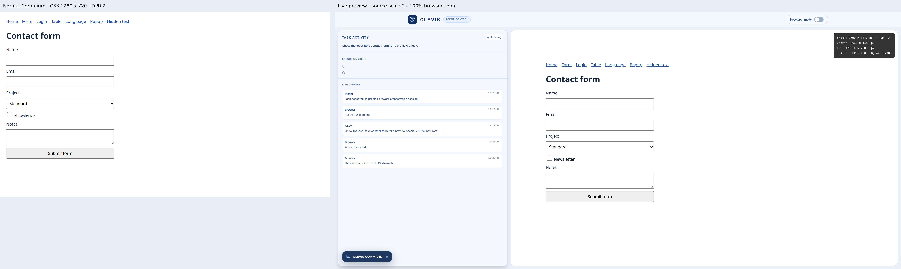

# Stream sharp browser previews over authenticated WebSockets

Replace legacy SSE JPEG screenshots with Playwright CDP screencast → in-memory PreviewHub → authenticated preview WebSocket → native-pixel canvas. Capture starts after browser startup independently of the agent, reattaches on navigation/tab changes/session closure, and stops with browser cleanup. Slow viewers have bounded latest-frame queues and send deadlines; they cannot delay acknowledgement, capture or the agent. The input WebSocket remains a stub.

## Blur root cause and fix

The [discovery report](discovery-report.md) identified JPEG quality 65, source scale 0.7 and an image stretched to fill its container. That discarded source pixels and then enlarged them. The replacement defaults to JPEG quality 85, requests full viewport × device-scale pixels, forwards encoded bytes unchanged, sets canvas internal dimensions to the image dimensions, and limits CSS size to frame pixels / device scale, fitting smaller containers without enlargement.

The installed Chromium also required a compositor viewport override: merely requesting 2560×1440 at scale 2 still produced 1280×720. Emulation.setDeviceMetricsOverride with its documented viewport scale produces actual HiDPI pixels while retaining 1280×720 CSS dimensions and the configured DPR. Encoded header dimensions are checked rather than inferred from CDP's DIP metadata. Initial window/navigation resize frames can be temporarily clipped; acknowledge/drop those, then wait up to three seconds for a full-size frame before falling back. This avoids treating a transient resize as permanent failure and never stretches a cropped frame.

## Requested visual comparisons

These composites compare the same empty **fake local form** in a normal Chromium page (left) and the actual product preview/debug overlay (right), at 100% browser zoom. They were created by starting runs through the frontend, not injecting a frame into the component. Scale 1 used a real headed source window; scale 2 used headless Chromium. Transport frames were never written to disk. Only these explicitly requested, controlled fake-data UI comparison artifacts were persisted; no private webpage, credential or raw transport capture was saved.

| Reading | Scale 1 / headed | Scale 2 / headless |
|---|---|---|
| Encoded frame | 1280×720 | 2560×1440 |
| Canvas internal size | 1280×720 | 2560×1440 |
| Canvas CSS size | 1280×720 | 1280×720 |
| Viewer devicePixelRatio | 1 | 2 |
| Painted FPS at the static-page snapshot | 1.0 | 1.0 |
| Encoded image bytes | 26,189 | 72,080 |
| First actual goal-page frame after Run Task | 1,951 ms | 2,110 ms |
| Capture mode | CDP live | CDP live |

[Machine-readable debug readings](assets/task-5-preview-readings.json). These static pages repaint little; the FPS is painted new frames, not heartbeat resends. Animated browser tests also verify continued capture under server throttling. Inspect the original image at native zoom for pixel-level comparison; a document viewer's fit-to-width mode necessarily scales these wide composites down.

## API, frontend scope and assumptions

- The only REST contract addition is **previewToken** in POST /api/runs' 201 response. The token is random, run-bound, stored separately from RunStore in process memory and sent in the first WebSocket message, never the URL. GET run state, SSE and the event contract are unchanged.
- Preview checks exact FRONTEND_ORIGIN and requires auth within the configured deadline. Unknown run closes 4404, missing/wrong/late auth 4401, wrong/missing Origin 4403. Native Uvicorn WebSocket ping and application JSON heartbeat both use 20 seconds; absent application pings close a dead viewer after about 40 seconds (4408). ASGI exposes no public native ping opcode, so transport pings stay Uvicorn's responsibility.
- Frames use the specified big-endian metadata-length prefix and untouched JPEG/PNG bytes. Metadata contains actual pixel dimensions, device/CSS viewport scales, CDP page scale and scroll offsets, UTC timestamp, sequence and opaque stable-per-page tabId. offsetTop is also included for future mapping; it is CDP metadata, not input handling.
- Both viewer and internal decode queues are bounded. Every received CDP frame is acknowledged before throttle/decode/viewer work; a closed target cannot accept an ack, but the acknowledgement is still attempted and triggers recovery. Tests assert every healthy-session frame is acknowledged, including throttled frames.
- Static-page health is checked independently of repaints. Idle resends reuse seq/ts and the latest RAM image; stalled is distinct from idle. Fallback captures native-resolution JPEG at the configured rate, emits fallback, and retries CDP every 30 seconds. Repeated attach/transport errors are bounded; ordinary navigation does not count as repeated transport failure.
- Stop/finish ends capture and sends the last image before ended. The last image remains in the hub for the retention interval, then is discarded. Application shutdown clears frames and tokens. Protocol DEBUG records are filtered to keep binary/auth payloads out of logs, even when verbose transport logging is enabled.
- Pillow is a runtime dependency because default fake-browser preview must also work without dev extras; tests use the same package for header/dimension assertions. Fake preview is an in-memory 640×360 JPEG grid/counter/timestamp, at up to 2 FPS.
- Frontend layout, idle panel, timeline components and styling are preserved. The preview component uses createImageBitmap, closes bitmaps, coalesces through requestAnimationFrame, keeps only the newest pending frame, pauses decoding/drawing when hidden, reconnects up to a five-second backoff, and stops reconnecting on ended. A slow bitmap decode still paints the newest completed image instead of starving while newer frames queue.
- The task's “preview component only” scope needed three small integration exceptions: pass runId/token from the create response through the hook/root; remove the legacy startUrl/maxSteps/maxSeconds body fields that otherwise cause 422 (optional URL is appended to the goal); enable Vite WebSocket proxying. Nested request errors are read safely. Broader timeline-field/state rewiring remains Task 8. Existing per-run limit controls remain visible while limits are server configuration; this task does not redesign them.
- Frontend test dependencies/scripts and AGENTS.md's formerly planned preview/test entries are updated. No takeover input, policy/auth framework, Node backend, source-frame storage, LLM changes or unrelated UI changes are introduced. The legacy /input handler body remains unchanged; only its shared preview decorator was removed.

## Protocol and installed API verification

Installed **Playwright Python 1.64.0**, bundled **Chromium 156.0.8078.4 (build 1248)**; Pillow **13.0.0**, websockets **17.2**. Checked the installed Playwright async signatures/docstrings and exercised the APIs in real headed/headless Chromium.

| API / field | What was verified |
|---|---|
| [Page.startScreencast](https://chromedevtools.github.io/devtools-protocol/tot/Page/#method-startScreencast) | format jpeg/png, optional quality, integer maxWidth/maxHeight and positive everyNthFrame. Send quality only for JPEG; request ceil(viewport × scale), never reduced source dimensions. |
| [Page.screencastFrame](https://chromedevtools.github.io/devtools-protocol/tot/Page/#event-screencastFrame) | Base64 data, metadata and integer sessionId. |
| [Page.screencastFrameAck](https://chromedevtools.github.io/devtools-protocol/tot/Page/#method-screencastFrameAck) / stopScreencast | Ack uses the received sessionId, even for discarded frames. Stop has no parameters. |
| [ScreencastFrameMetadata](https://chromedevtools.github.io/devtools-protocol/tot/Page/#type-ScreencastFrameMetadata) | deviceWidth/deviceHeight are DIPs, offsetTop is DIP, scrollOffsetX/Y are CSS pixels, pageScaleFactor is a scale, timestamp is optional epoch time. Image header gives encoded pixel dimensions. |
| [Emulation.setDeviceMetricsOverride](https://chromedevtools.github.io/devtools-protocol/tot/Emulation/#method-setDeviceMetricsOverride) / Page.Viewport | width, height, deviceScaleFactor, mobile and viewport x/y/width/height/scale. Verified full viewport via a bottom-right pixel marker, stable innerWidth and native encoded sizes at both scales. No deprecated visible-size or window-management API is used. |
| [Page.getLayoutMetrics](https://chromedevtools.github.io/devtools-protocol/tot/Page/#method-getLayoutMetrics) | No parameters; bounded health request keeps static pages live. Its content is not logged or placed in events. |
| [Playwright CDPSession](https://playwright.dev/python/docs/api/class-cdpsession) | Async context.new_cdp_session(page), send(method, params), detach, on protocol events, and close event (available since 1.59). Also checked on/remove_listener for main-frame navigation. |
| [Page.screenshot](https://playwright.dev/python/docs/api/class-page#page-screenshot) | type=jpeg, quality and scale=device, in-memory bytes when no path is supplied. Used only as fallback; never resized/re-encoded. |

Protocol fields were cross-checked against the [official Chromium protocol JSON](https://github.com/ChromeDevTools/devtools-protocol/blob/master/json/browser_protocol.json). Unsupported experimental methods fail into the documented fallback; no public Chrome debugging port is opened.

## Validation

- Backend `.venv/bin/pytest -q`: **246 passed, 5 skipped** in 87.28 seconds (one upstream Starlette/httpx deprecation warning). Five explicitly paid live-LLM tests skip by default; Task 5 makes no billable model requests.
- `ruff check .` and strict `mypy .` pass (73 source files); editor BasedPyright has zero errors, warnings or notes. A real scale-2 typed-search/click check also passed with CDP capture active.
- Frontend `npm test`: **17 passed**; `npm run build`: **passed** (Vite 6.4.3); tests cover decoder errors/large payloads, native/CSS sizing at scale 1 and 2 with larger/smaller containers, status overlays, first-message auth, hidden-tab behavior, latest-frame drawing, slow decode, reconnect and debug readings.
- Real WebSocket tests launch Uvicorn and authenticate a network client; headless scale 1/2 and headed smoke receive JPEGs within three seconds, stream the actual goal page, end cleanly, retain/purge the last frame and check owned Chromium processes exit.
- Browser tests cover full pixel dimensions/corner markers, raw-byte preservation, navigation, popup/tab close, forced session detach, no-first-frame fallback, forced-start fallback/retry, static resend and animation with a nonreading bounded viewer.
- Unit/auth tests cover framing including multi-megabyte images/empty metadata, dropped-frame acknowledgement accounting, queue limits, status transitions, correct/wrong/missing/run-mismatched auth, timeout, Origin, ping/dead-client cleanup, retention, privacy and application shutdown.
- Actual frontend dev server started on localhost:5173, source/test site on localhost:8000/127.0.0.1:8765 during the controlled comparison checks. Final verification servers are stopped afterward.
- Frontend installation initially hit an npm 9 peer-resolver crash; the legacy peer resolver completed installation, with the DOM peer declared explicitly. A final normal `npm ci --no-audit --no-fund --cache /tmp/wto-npm-cache` succeeded (435 packages, 44 seconds), followed by all tests and the production build. The lockfile is updated; no frontend dependency was removed.

Changes follow the requested eight commits: config/framing/hub; CDP/acks; recovery/idle/fallback; WebSocket auth/lifecycle; fake pattern; frontend renderer/tests; debug overlay; headed/network regression checks, comparisons and documentation. No PR was published from this workspace.
